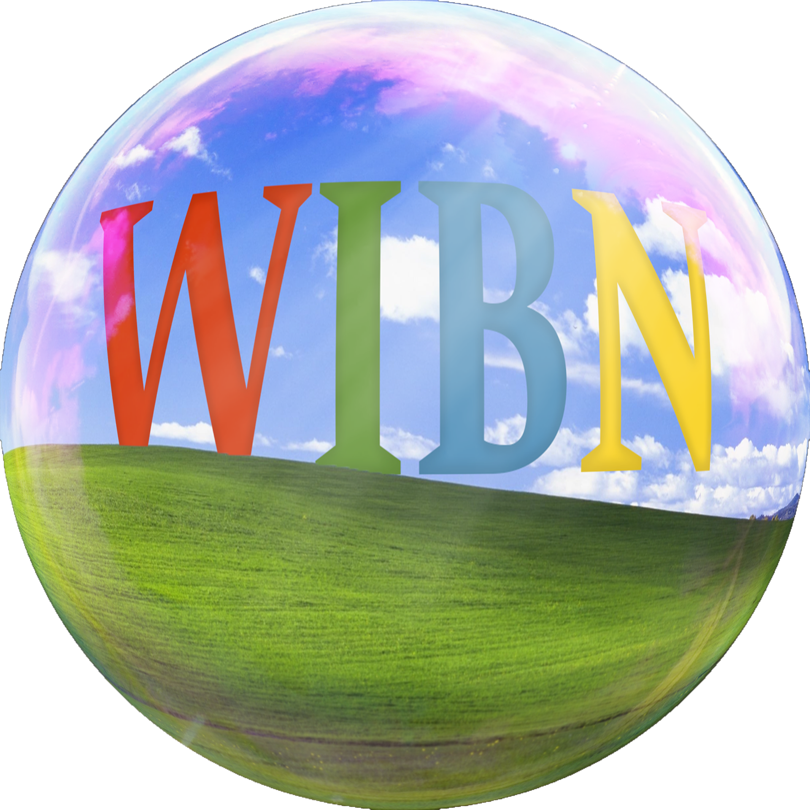

  

<h1 align="center">Wibn</h1>

<b>My Windows is better now</b> · Extra features for Windows 11

  <a href="https://github.com/YosefY77/wibn/releases/latest"><b>⬇️ Download the latest version (Wibn-Setup.exe)</b></a>

---

## What's new in 2.8

- **Safer sign-in for video downloads:** your session is saved encrypted with your Windows account, Wibn paces its requests to protect your account, and it checks the download tools' SHA-256 fingerprint before running them
- **Use your browser's sign-in** (optional, off by default): downloads can use the session from your default browser
- **Desktop panel kinds:** your files are grouped into programs, games, folders and files; drag the groups into any order, and right-click an item → *Classify as…*
- **Pin on top:** keep any window above the others from its title-bar menu
- **Scrolling titles:** long titles on the playback bar and the Now playing widget slide to show all of it
- **Favorites:** adding a page to favorites puts a shortcut to it at the top
- Much less memory used with *Show in streams* on, plus many fixes

## Features

### Taskbar and desktop

| Feature | What it does |
|---|---|
| **Wibn taskbar** | Replaces Windows' taskbar: pinned and open apps with live window previews, full / floating / dock shapes, glass or color, top or bottom, scroll on an app to change its volume |
| **Info bar** | An extra bar with the time, Hijri date, next prayer, CPU and GPU use and temperature, memory, network and disk |
| **Spot the window** | Hover a window preview to see that window in its place before you click |
| **Liquid Glass** | iPhone-style glass for the taskbar and widgets that shows what's behind it live |
| **Widgets** | Weather, now playing, sound waves, calendar and appointments, shortcuts, quick actions and more, lined up with your desktop icons |
| **Desktop panel** | Your desktop files from the corner, grouped by kind |
| **Wallpapers** | All your wallpapers in one list, switched with one key, with transitions and video wallpapers |
| **Animations** | Widgets fading in, minimize animations, and how fast windows open |
| **Desktop** | Color of the selection box and the mouse cursor |

### Files

| Feature | What it does |
|---|---|
| **Cleanup** | Biggest files, temp files, duplicates and the Recycle Bin |
| **File lock** | Lock files and folders with a password; they lock themselves again |
| **Downloads organizer** | Sorts files into folders by type |
| **Convert formats** | Drag a file and press `Space` |
| **Resize** | Drag an image or video and press `R` |
| **Compress** | Drag a file and press `C`, smaller without losing quality |
| **Archive** | Drag files or a folder and press `Z` to make a ZIP, 7Z or RAR |
| **File transfer** | Send files straight to any device over the internet |

### Media

| Feature | What it does |
|---|---|
| **Video downloader** | `Ctrl+H` and paste a link from YouTube, Instagram, X, Reddit, TikTok or Spotify; trim a video before downloading |
| **Screen capture** | Off by default. Pick a shortcut for each: a part you select, the full screen, a video (1 minute by default), or save the last minute |
| **App volumes** | Each app's volume on its own |

### System

| Feature | What it does |
|---|---|
| **Game mode** | Game Booster Mode, and *Lighten Windows* to turn off background work (everything can be undone) |
| **Keyboard shortcuts** | Your own shortcuts that work anywhere |
| **RAM usage** | The apps using the most RAM |
| **Startup apps** | Turn off apps that start with your PC |
| **PC specs** | Everything about your PC in one place |
| **Settings in a file** | Save all of Wibn's settings to a file and load them on another PC |

Every page has a **!** button that explains each feature.

## Privacy

- No account and no tracking. Wibn only goes online for what you use: updates, weather, downloads and file transfer.
- The sign-in for video downloads stays on your PC, encrypted with your Windows account, and is never included in exported settings.
- The download tools ([yt-dlp](https://github.com/yt-dlp/yt-dlp), [gallery-dl](https://github.com/mikf/gallery-dl)) are open source, and Wibn checks their fingerprint before running them.

## Install

1. Download **[Wibn-Setup.exe](https://github.com/YosefY77/wibn/releases/latest)** and run it.
2. Choose only the features you want. You can add the rest later in **General settings → Features**.
3. Wibn starts with Windows and sits next to the clock.

**Updates:** Wibn tells you when a new version is out, and you update with one click.

**Requires:** Windows 11.

## Support

Wibn is free. If you like it, you can support the developer from **General settings → Support Wibn**.

## License

Wibn is open source under the [MIT License](LICENSE).
